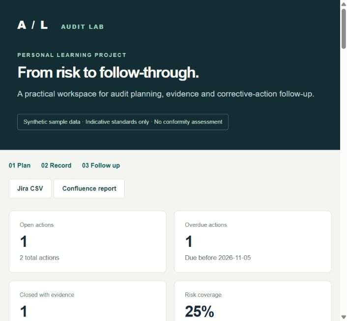

# Security Audit Workflow Lab

A new **AI-assisted educational portfolio prototype**, created on **5 November 2026**. It demonstrates risk-based audit planning, evidence records, corrective-action follow-up and transparent operational indicators using **synthetic sample data**.

This is a working local application, not experience auditing a real organisation. It contains no personal or healthcare records and makes no ISO/NEN conformity or certification claim.



## Run

Python 3.10 or newer; standard library only. From this directory:

```sh
python app.py --demo
```

Open **http://127.0.0.1:9877**. Stop with Ctrl+C. A local SQLite database is created in `data/lab.sqlite3` (excluded from Git). Omit `--demo` to start with an empty workspace. `--db path/to/other.sqlite3` and `--port 9878` select another workspace/port.

## Try the complete workflow

1. Register a fictional process risk with likelihood and impact from 1 to 5 and an indicative standard label.
2. Plan an audit: choose an auditor label different from the process owner. The plan sorts highest risk score first.
3. Record a finding **or positive observation**, with a fictional evidence reference. An observation record is required before marking an audit completed; this does not mean every audit must have a nonconformity.
4. Assign a corrective action to a finding, owner label and due date.
5. Move it through **Open → In progress → Ready for review → Closed**. Closure requires evidence and a reviewer label different from the action owner. Reopening returns to In progress and clears the current closure fields while preserving history.
6. Review the dashboard, timestamped activity and exports. Restart the application to check persistence.

The sample contains three risks, three planned/completed audits, one finding and two corrective actions. All names are role labels. The sample action due 3 November 2026 demonstrates overdue follow-up.

## Implemented features

- Risk register with validated likelihood/impact and `risk score = likelihood × impact`.
- Risk-prioritised audit planning with an elementary auditor-independence check.
- Linked audit, observation, evidence and corrective-action records.
- Action ownership, due dates, controlled status transitions and evidence/reviewer requirements for closure.
- Transaction-backed timestamped activity; invalid changes leave existing records/history intact.
- SQLite persistence; user input escaped in the browser.
- **Jira CSV template export** and **Confluence-ready Markdown report**. These are files for review/import or copy/paste, not live integrations or evidence of Jira/Confluence administration.
- Local-only HTTP server with Host/Origin validation, bounded JSON requests, a custom write header and a restrictive content security policy.

## Indicators and exact denominators

| Indicator | Definition |
| --- | --- |
| Open actions | All actions whose status is not Closed. |
| Overdue actions | Open actions with due date strictly before the stated date; due today is not overdue. |
| Closure rate | Closed actions / all actions × 100; `null` when no actions exist. |
| Closed with evidence | Count of closed actions with nonempty evidence and reviewer fields. |
| Completed-audit risk coverage | Distinct risks linked to a completed audit / all registered risks × 100; `null` when no risks exist. |

These indicators expose workflow state; they do **not** prove audit quality, corrective-action effectiveness or coverage of standard clauses. `snapshot(as_of=...)` changes the overdue cutoff; it does not reconstruct historical state.

## Standards and method

The catalogue labels ISO 19011, ISO 27001, NEN 7510, ISO 9001, ISO 27701 and ISO 27018 organise the exercise. No copyrighted clauses/checklists were copied and no compliance rules are implemented. The risk matrix, status workflow and indicators are original learning choices, not assertions that the standards prescribe this exact design.

Primary overview references:

- [ISO/IEC 27001: information security management](https://www.iso.org/standard/27001)
- [ISO 19011: auditing management systems](https://www.iso.org/standard/19011)
- [NEN: information security in healthcare](https://www.nen.nl/zorg-welzijn/ict-in-de-zorg/informatiebeveiliging-in-de-zorg)

The conceptual link is to examine a process, prioritise work using risk, record evidence, follow up findings and make progress visible. Applying a standard in a real organisation requires the relevant licensed text, context and competent review.

## Exports

`/exports/jira.csv` produces generic Issue Type, Summary, Description, Status, Due Date and Labels columns. Owners are **descriptive role labels**, not Jira account IDs. Review project permissions, importer mappings, user identities, dates and available statuses before importing. Formula-leading text is neutralised. No import into Jira was tested.

`/exports/confluence.md` produces a Markdown report with indicators, the plan, actions and scope. Confluence rendering/import varies; the file is a starting point, not a tested deployment.

## Tests

```sh
python -m unittest discover -s tests -v
```

Tests cover score bounds and priority order, independence labels, evidence requirements, valid transitions, atomic rejection, reopening/history, overdue cutoff, denominator handling, distinct-risk coverage, persistence, export escaping, dates/labels, synthetic demo seeding and local HTTP boundaries. See `docs/verification.md` and `evidence/tests.txt` for recorded results.

## Boundaries

This localhost learning app has no authentication or real identity verification. Auditor/reviewer independence compares role labels only. It has no multi-user authorisation, tamper-evident audit trail, attachments, standard-clause mapping, evidence-quality assessment or production deployment. History is an ordinary SQLite table, not immutable evidence. Keep fictional/non-sensitive data on localhost.

## CV wording

> New AI-assisted portfolio project: built a local risk-based audit-planning and corrective-action workflow using Python/SQLite, synthetic data and timestamped follow-up.
>
> Defined transparent workflow indicators, tested evidence-based closure and exported Jira CSV and Confluence-ready reports; standards are indicative study labels, not certified compliance.

Do not describe this project as conducting real ISO/NEN audits, deploying a certified ISMS, or managing live Jira/Confluence environments.

## Licence

MIT; see `LICENSE`.
